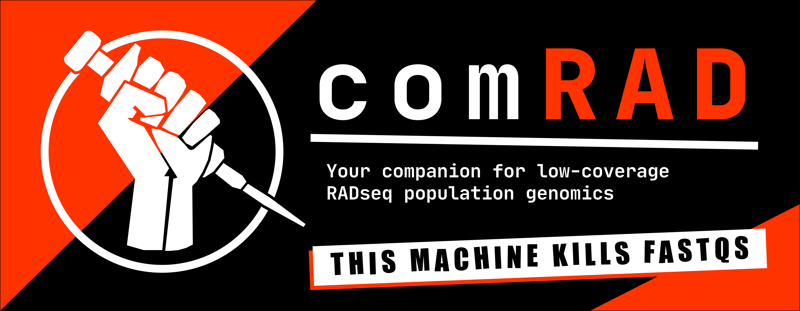
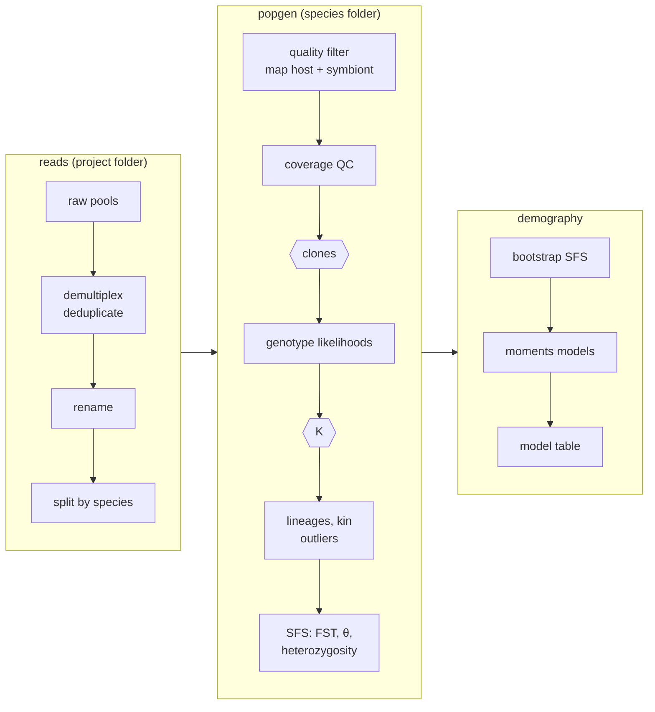

<p align="center">
  
</p>

[](https://ryaneckert.github.io/comRAD/)
[](https://github.com/RyanEckert/comRAD/releases)
[](LICENSE)
[](https://github.com/RyanEckert/comRAD/actions/workflows/tests.yml)


comRAD takes reference-mapped RADseq data, built for 2bRAD, from raw reads to clones,
population structure, lineages, kinship, diversity and F<sub>ST</sub>, with demographic models
as an extra. It runs on a SLURM cluster as three pipelines that submit and watch their own jobs,
and it stops to ask you only where a human should decide.

It was written for corals and other host/symbiont systems: reads are mapped to the host and to
a symbiont metagenome and split between them. Leave the symbiont genome out and it runs host
only.

## Why

Low-coverage RADseq analyses are long chains of tools (ANGSD, PCAngsd, NGSadmix, evalAdmix,
NGSremix, realSFS, moments) joined by many small decisions: filters, thresholds, sample lists,
what to drop and why. Done by hand, those decisions end up scattered across notebooks and job
scripts. ```comRAD``` puts them in one config file per analysis, runs the chain the same way every
time, and records what it did.

- **Genotype likelihoods throughout**, so low depth per sample is handled rather than filtered away.
- **Clones called from genotype distance** when coverage allows, IBS when it doesn't, with the cut
  set by your technical replicates. It separates clones from close relatives even in highly
  heterozygous species.
- **Decisions stay with you.** The run pauses at the clone dendrogram and at *K* selection with the evidence
  laid out; you answer in the config, so the answer is recorded.
- **Checks built in.** Replicate checks, a neutral (and kin-free if chosen) rerun of the lineage calls,
  heterozygosity tested against coverage, convergence checks on every spectrum and model.
- **Plots at every step**, in your own colours and order, collected in an HTML report.
- **A record of the run**: a diary with the numbers for your methods, every tool's version, and
  every setting in effect.

## How it works



| pipeline | run from | does | ends with |
|---|---|---|---|
| `reads` | project folder | download, demultiplex and deduplicate, rename, split by species | `<species>/demuxReads/*.demux.fastq.gz` |
| `popgen` | species folder | QC, mapping, clones, genotyping, structure, K, kin, lineages, outliers, SFS, F<sub>ST</sub>, diversity | `<SP>Results.tar.gz` |
| `demography` | species folder, after popgen | contig-bootstrap spectra, moments models, model table and checks | `<SP>Demography.tar.gz` |

`comrad run` submits one small driver job that runs the steps in order. Each step hands its jobs
to `comrad-jobs`, which submits them as a SLURM job array, reruns only what fails (with more
memory, on the long partition, or on another node, as the failure needs) and records what each
job used. Run it again after a pause or a stop and it carries on where it was.

## Install

```bash
python3 -m pip install --user git+https://github.com/RyanEckert/comRAD.git
comrad setup --prefix /path/to/storage/comradDeps     # finds or installs ANGSD, bowtie2, samtools, NGSadmix, ...
echo 'source /path/to/storage/comradDeps/comrad.env' >> ~/.bashrc && source ~/.bashrc
```

Python 3.9 or newer and SLURM; R is not needed. `comrad setup` uses environment modules,
conda (installing Miniforge if there is none) or a source build, all inside `--prefix`. See
[Install](https://ryaneckert.github.io/comRAD/install/).

## Use

```bash
cd myProject
comrad init cluster && nano cluster.config      # partitions, node memory, email
comrad init reads   && nano reads.config        # sample sheet, species prefixes
comrad run reads

cd sint
comrad init popgen  && nano popgen.config       # genome, metadata, technical replicates
comrad check popgen
comrad run popgen                               # pauses at the clone dendrogram, then at K
comrad summary popgen                           # what each step found, and what waits on you
nano popgen.config                              # CLONE_PAUSE = no, then K = 2
comrad run popgen
comrad report popgen                            # run/popgen/popgenReport.html

comrad init demography && nano demography.config
comrad run demography
```

Filled-in example configs, a sample sheet and a metadata table are in [`examples/`](examples/).

## Documentation

**[ryaneckert.github.io/comRAD](https://ryaneckert.github.io/comRAD/)**: install, quick start,
a full tutorial, a guide to each pipeline, worked examples, every setting, command and script,
and troubleshooting.

## Citation

If you use comRAD, please cite it ([`CITATION.cff`](CITATION.cff), or GitHub's "Cite this
repository") and the tools it runs: ANGSD, PCAngsd, NGSadmix, evalAdmix, NGSremix, ngsParalog,
bowtie2, samtools, cutadapt and moments. [About](https://ryaneckert.github.io/comRAD/about/)
lists the references and the earlier work some scripts are ported from (Mikhail Matz's
2bRAD_denovo, Matteo Fumagalli's ngsTools, treeTrimmer).

## License

GPL-3.0-or-later; see [`LICENSE`](LICENSE).
