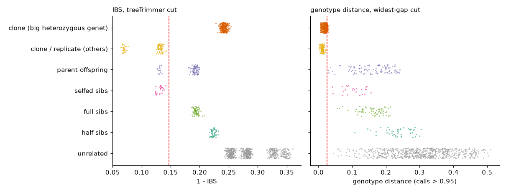

# Clone calls on a simulated pedigree

Real data never tell you which pairs truly are clones. A simulation does. `simCloneKin.py`
builds a population with every kind of pair the clone step has to tell apart, draws reads for
each sample at a chosen coverage, and writes the same files ANGSD would (genotype probabilities
and an IBS matrix), plus a table of the true relationship of every related pair.

## The design

Two lineages (F<sub>ST</sub> 0.1), each with:

- 12 unrelated founders;
- 4 full-sib families of 3 offspring, with both parents sampled (parent–offspring pairs);
- 2 half-sib groups;
- 1 selfed family (a parent and 3 selfed offspring), the closest relatives a clonal coral can have;
- 4 genets with 1–3 extra clone ramets (with a few somatic mutations);
- 2 colonies sequenced 3 times as technical replicates;
- 6 weak samples at about 2x, all clones or replicates of others.

About 125 samples and 8000 SNPs; coverage varies between samples around the median. Three runs:

| run | command | what it adds |
|---|---|---|
| good coverage | `simCloneKin.py -o simA` | median 7x |
| a big heterozygous clone | `simCloneKin.py -o simP --big-clone 25 --fixed-het 0.3` | one genet with 25 ramets and extra heterozygosity, like *P. astreoides* |
| low coverage | `simCloneKin.py -o simL --cov 2.5` | median 2.5x |

Each was scored with `cloneGroups.py` as the clone step runs it, then compared with the truth
(this is `tests/sim_clones.sh`).

## Results

Clone pairs grouped (of all true clone and replicate pairs), and relatives wrongly grouped with
them:

| run | distance | cut | clone pairs grouped | relatives grouped as clones |
|---|---|---|---|---|
| good coverage | IBS | treeTrimmer | 89 / 89 | 15 parent–offspring, 24 selfed-sib |
| | **genotypes (0.99)** | widest gap | **89 / 89** | **none** |
| big heterozygous clone | IBS | treeTrimmer | 89 / 389 | 15 parent–offspring, 24 selfed-sib |
| | **genotypes (0.95)** | widest gap | **389 / 389** | **none** |
| low coverage | **IBS** | treeTrimmer | **89 / 89** | 15 parent–offspring, 24 selfed-sib |
| | genotypes (0.95) | widest gap | 87 / 89 | 20 parent–offspring, 9 selfed-sib, 2 full-sib, 2 half-sib |

Bold rows are what `CLONE_METRIC = auto` chose.

- **At good coverage, genotype distance is right and IBS is not.** IBS finds every clone but also
  merges parent–offspring pairs and selfed sibs, which share half or more of their alleles.
- **A heterozygous clone breaks IBS.** The 25 ramets of the heterozygous genet sit far apart in
  IBS (each pair of libraries draws different alleles at its many heterozygous sites), well
  above the cut set by the replicates, so IBS misses 300 of its clone pairs. Genotype distance
  groups all of them.
- **At low coverage, IBS is the better choice.** Too few sites have confident genotype calls in
  both samples, and genotype distance makes more mistakes. The `auto` checks detect this (only
  29% of pairs share 1000 confident sites at 0.99) and fall back to IBS. IBS still merges close
  relatives at this coverage, which is why `<SP>CloneBorderline.txt` lists each join near the cut
  with both sides' coverage.

## Every pair, by its true relationship

Each dot is a pair of samples from the run with the big heterozygous clone, placed at its
distance and sorted by how the two are truly related; the red line is the cut comRAD chose. A
correct call puts every clone pair left of the line and every other pair right of it.



- **IBS (left).** The big genet's ramets sit at about 0.24, among the half-sibs and unrelated
  pairs, far right of the cut: each pair of libraries draws different alleles at its many
  heterozygous sites. Meanwhile a share of parent–offspring pairs and all selfed sibs sit left of
  the cut, as close as the replicates.
- **Genotype distance (right).** Every clone pair, the big genet included, sits near zero; the
  closest relatives start above 0.03, and the cut falls in the gap between them.

## The cuts

Each distance needs its own cut:

- **Genotype distance: the widest gap just above the replicates.** Clones and replicates sit near
  zero and relatives much higher, so the tree has a clear gap. comRAD takes the widest gap whose
  lower edge is within three times the replicates' largest distance (so it cannot jump to the
  gap between relatives and unrelated samples) and cuts at its bottom. treeTrimmer would cut too
  low here: replicates are often tighter than clones that include a weak library.
- **IBS: treeTrimmer.** IBS never starts near zero, so there is no gap to find at the bottom of
  the tree; the replicates' deepest join × `TREE_BUFFER` is the better rule.

## Run it yourself

```bash
simCloneKin.py -o simTest                     # or with --big-clone, --cov, --fst ...
cd simTest
cloneGroups.py -i cloneTests/base/sim.ibsMat -g cloneTests/base/sim.geno.gz -b simBams \
  -r "$(cat techreps.txt)" -o sim             # what the clone step does
cloneTestScore.py -s sim -r "$(cat techreps.txt)" --truth truth.tsv --plot sim.pdf
                                              # every distance and cut, scored against the truth
```

On your own data, `cloneTestRun.py` reruns the clone step's ANGSD with a set of filter variants
and `cloneTestScore.py` compares them, without the truth.
