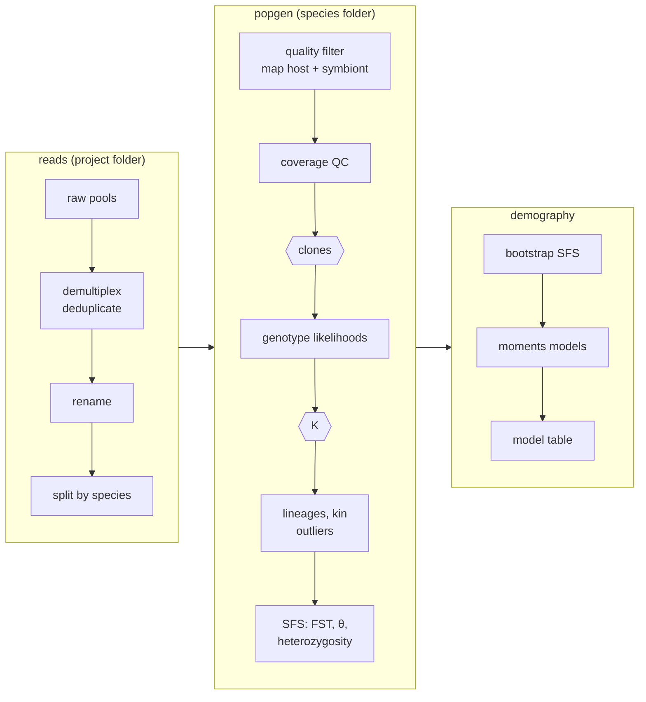

# comRAD

**Your companion for low-coverage RADseq population genomics.**

comRAD takes reference-mapped RADseq data, built for 2bRAD, from raw reads to clones,
population structure, lineages, kinship, diversity and FST, with demographic
models as an extra. It runs on a SLURM cluster as three pipelines that submit and watch their
own jobs, and it stops to ask you only where a person should decide.

It is built for corals and other host/symbiont systems: reads are mapped to the host and to a
symbiont metagenome and split between them. Leave the symbiont genome out and it runs host only.

## Why comRAD

Low-coverage RADseq analyses are long chains of tools (ANGSD, PCAngsd, NGSadmix, evalAdmix,
NGSremix, realSFS, moments) joined by many small decisions: filters, thresholds, sample lists,
what to drop and why. Done by hand, those decisions end up scattered across notebooks and
job scripts. comRAD puts them in one config file per analysis, runs the chain the same way
every time, and keeps a record of what it did.

- **Genotype likelihoods throughout.** Every step works from ANGSD genotype likelihoods, so
  low depth per sample is handled rather than filtered away. Only per-individual
  heterozygosity uses a depth floor.
- **Clones from genotypes, not just reads.** Clones are called from genotype distance when
  coverage allows and from IBS when it doesn't, with the cut set by your technical replicates.
  This separates clones from close relatives even in highly heterozygous species
  ([why](examples/clones-past.md)).
- **Decisions stay with you.** The run pauses at the clone dendrogram and at K, with the
  evidence laid out. You answer in the config, so the answer is recorded.
- **Checks built in.** Technical replicates calibrate and test the clone threshold; a neutral,
  kin-free rerun checks the lineage calls; heterozygosity is tested against coverage; spectra
  and models are checked for convergence. Problems that don't stop the run become warnings.
- **Plots at every step.** Each step draws quick-look plots (PCA, admixture for every K,
  kinship, outlier scans, FST, diversity) in your own colours and order, collected
  in an HTML report.
- **A record of the run.** A diary of every step with the numbers for your methods, the
  versions of every tool, every setting in effect, and an HTML report.

## How it works

The two hexagons are the pauses where you decide.

Each pipeline is a fixed list of steps. `comrad run` submits one small driver job that runs
them in order; each step builds a list of jobs and hands it to `comrad-jobs`, which submits
them as a SLURM job array, reruns only what fails (with more memory, on the long partition, or
on another node, as the failure needs), and records what each job used. Run it again after a
pause or a stop and it carries on from where it was.

| pipeline | run from | does | ends with |
|---|---|---|---|
| `reads` | project folder | download, demultiplex and deduplicate, rename, split by species | `<species>/demuxReads/*.demux.fastq.gz` |
| `popgen` | species folder | QC, mapping, clones, genotyping, structure, K, kin, lineages, outliers, SFS, FST, diversity | `<SP>Results.tar.gz` |
| `demography` | species folder, after popgen | contig-bootstrap spectra, moments models, model table and checks | `<SP>Demography.tar.gz` |

## Where to go next

- [Install](install.md) comRAD and the programs it runs.
- [Quick start](quickstart.md): the commands for one project, start to finish.
- [Tutorial](tutorial.md): the same project, explained step by step.
- The guide, one page per stage: [before you start](guide/setup.md), [reads](guide/reads.md),
  [popgen](guide/popgen.md), [clones and K](guide/decisions.md),
  [results, plots and the report](guide/results.md), [demography](guide/demography.md), and
  [running and rerunning](guide/running.md).
- Worked examples: [clones in a highly heterozygous coral](examples/clones-past.md) and
  [clone calls on a simulated pedigree](examples/clone-simulation.md).
- Reference: every [setting](reference/settings.md), every [command](reference/commands.md),
  every [script](reference/scripts.md).
- [Troubleshooting](troubleshooting.md), and [citing comRAD](about.md).
